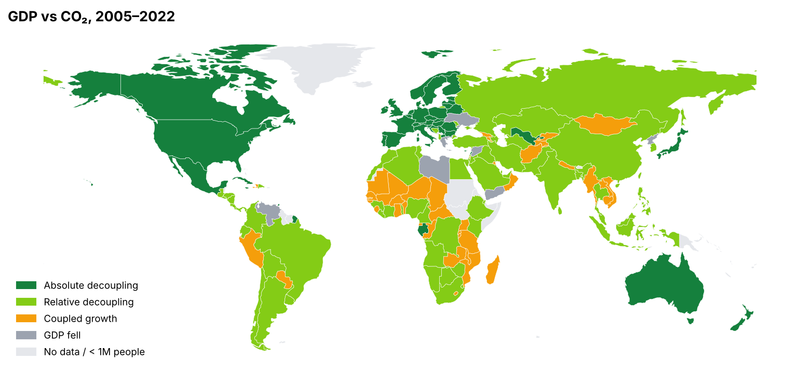
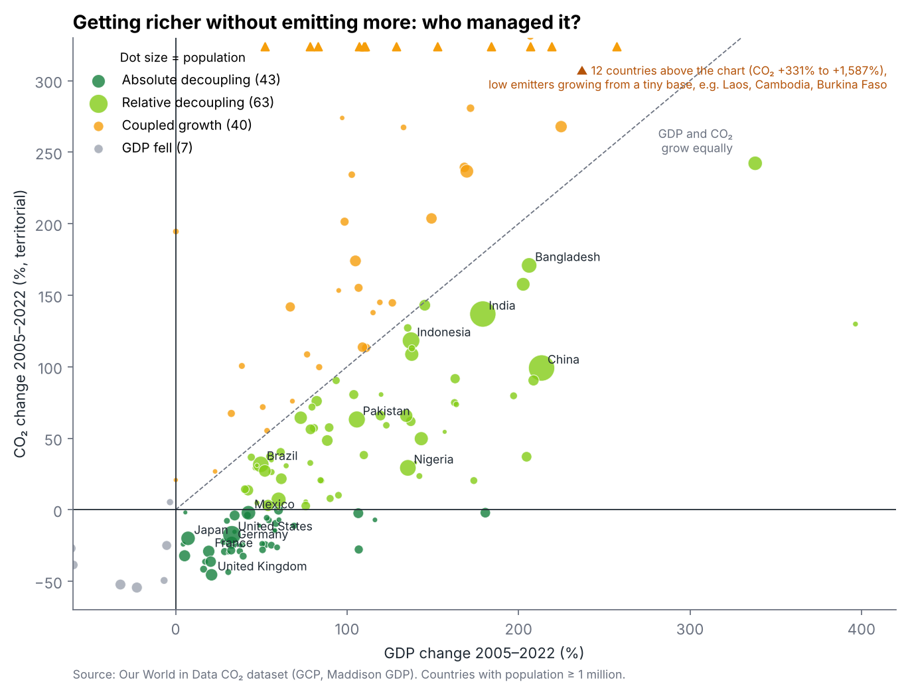
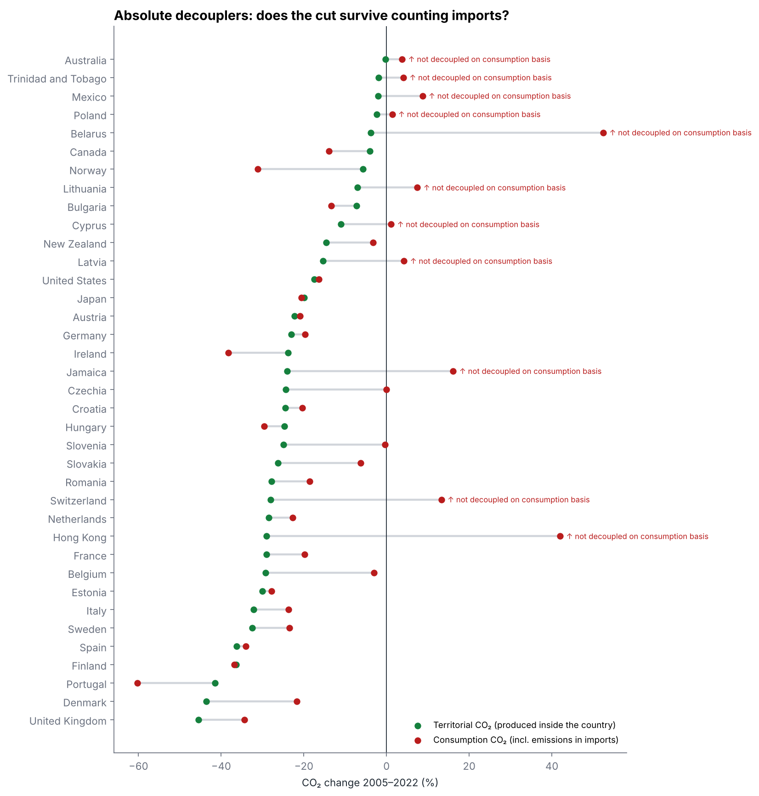
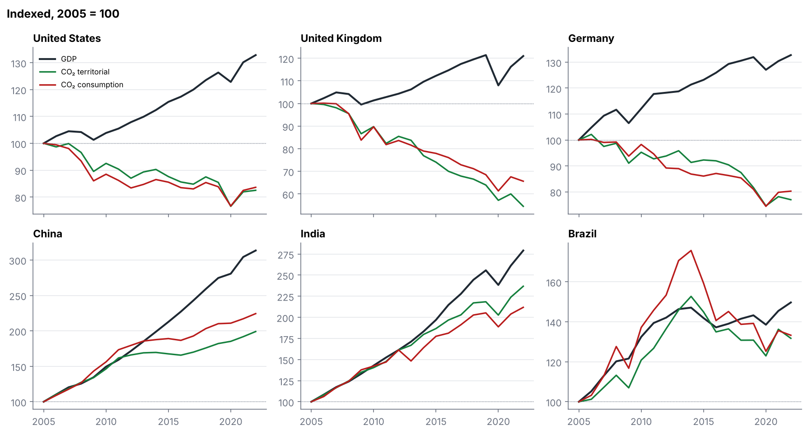

# Who Got Richer While Cutting CO₂? (2005–2022)

Using Our World in Data's CO₂ dataset, this project asks which countries grew their economy **and** cut emissions at the same time, and whether that still holds once the emissions embedded in imported goods are counted.



## Findings

| Question | Answer |
|---|---|
| How many countries cut CO₂ while growing? | **43 of 153** countries (population ≥ 1M) achieved *absolute decoupling*: GDP up, territorial CO₂ down. Another 63 grew GDP faster than CO₂ (*relative decoupling*), 40 grew CO₂ faster than GDP, and 7 saw GDP fall. |
| How much of the world is that? | The 43 absolute decouplers emitted **29%** of world CO₂ in 2022. World CO₂ still rose **+27%** while GDP of reporting countries rose **+77%**. |
| Big economies | USA: GDP +33%, CO₂ −17%. UK: GDP +21%, CO₂ −45%. Germany: GDP +33%, CO₂ −23%. China: GDP +213%, CO₂ +99%. India: GDP +179%, CO₂ +137%. |
| Does it survive counting imports? | Of the 37 absolute decouplers with consumption data, **26 remain decoupled** on a consumption basis; **11 do not** (incl. Switzerland, Poland, Australia, Mexico, Hong Kong). Median CO₂ cut shrinks from **−24%** (territorial) to **−16%** (consumption). |



## The data trap: where are the emissions counted?

Standard ("territorial") CO₂ counts emissions produced inside a country. A country can lower that number by importing goods instead of making them, so the emissions move to another country's account. Consumption-based CO₂ re-assigns emissions to the country where the goods are consumed.

Re-checking every absolute decoupler on that basis shows that the large cuts (UK, Germany, USA, France, Nordic countries) are mostly real. The UK's cut shrinks from −45% to −34% but remains large. Several smaller "decouplers", however, are not decoupled once imports are counted: Switzerland goes from −28% to **+13%**, and Hong Kong from −29% to **+42%**.





## Method

- **Data:** OWID CO₂ dataset (Global Carbon Project emissions; GDP from the Maddison Project, constant international dollars). GDP is available through 2022, which sets the end year.
- **Sample:** rows with a 3-letter ISO code (excludes OWID regional aggregates), population ≥ 1 million, and GDP and CO₂ in both 2005 and 2022 → 153 countries.
- **Categories:** GDP fell; absolute decoupling (GDP ↑, CO₂ ↓); relative decoupling (both ↑, GDP % > CO₂ %); coupled growth (CO₂ % ≥ GDP %).
- **World GDP:** OWID's "World" row has no GDP, so world GDP growth is the sum over countries reporting GDP in both years.
- **Map:** Natural Earth 1:110m countries, joined on ISO_A3 with ADM0_A3 as fallback for the five countries coded "-99" (e.g. France, Norway).

## Limitations

- Change between two years is sensitive to the endpoints. 2005 was before the financial crisis; 2022 was a post-COVID rebound year.
- Consumption-based CO₂ is modelled from trade data and is more uncertain than territorial CO₂.
- Some large percentage increases (Laos, Cambodia) start from very low emissions per person.

## Run

```bash
pip install pandas numpy geopandas matplotlib
python analyze.py          # reads data/raw/, writes output/
```

**Sources:** [Our World in Data — CO₂ and Greenhouse Gas Emissions](https://github.com/owid/co2-data) · [Natural Earth](https://www.naturalearthdata.com/)

*Author: Axror Abduhamitov, 2026*
